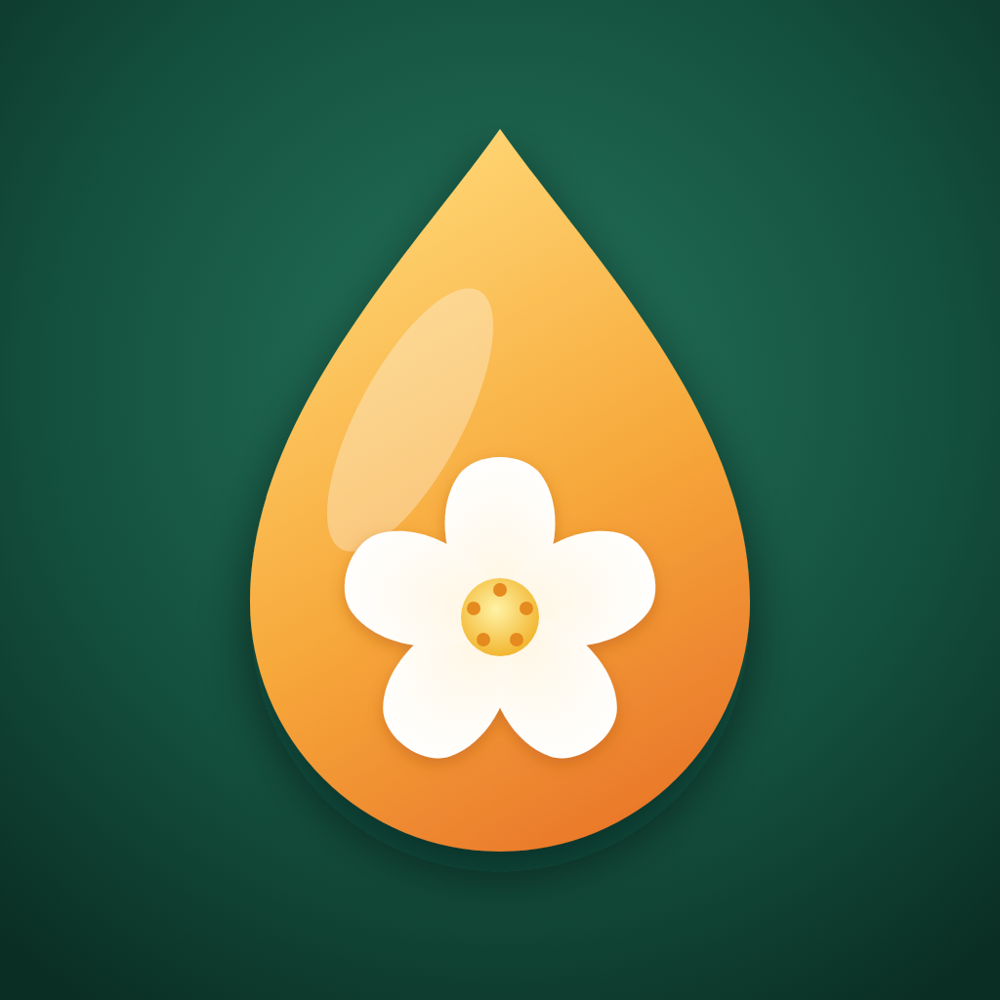

# Neroli

 
*iOS Build does pass. Building using runners outside of GitHub at this moment during development.
 
 
**Neroli** is an iOS port of [Azahar](https://github.com/azahar-emu/azahar), a free and open-source high level Nintendo 3DS emulator for PC and mobile devices. Azahar's goal is to give 3DS owners a place to enjoy their library of titles with improvements to the original hardware, such as higher resolutions, modern controllers or save states. The emulator also serves as a debugging hub for homebrew developers and as a research and preservation platform for the 3DS ecosystem.

Azahar continues the legacy of **Citra** and is actively developed by a community of contributors. The name Neroli comes from the oil of orange blossoms, *azahar* in Spanish.

*Neroli is not affiliated with or endorsed by Nintendo or by the Azahar developers.*

This fork of Azahar is called Neroli (formerly Azahar-iOS). I am only focused on the iOS port and I am not affiliated with the upstream developers. All features currently supported in the main Azahar upstream project have been ported. This also supports various iOS specific programming such as:

<ul><li>MetalFX Upscaling</li>
<li>Apple Frame Generation (will scale generated frames down automatically depending on performance, WIP)</li>
<li>Native custom Metal Renderer</li>
<li>Code improvements for Apple GPUs</li>
<li>Frame Pacing </li>
<li>Refresh Rate Selection of 60hz or 120hz</li>
<li>Universal.js for JIT (use StikDebug or StosDebug)</li>
<li>Supports LiveContainer</ul></li>
